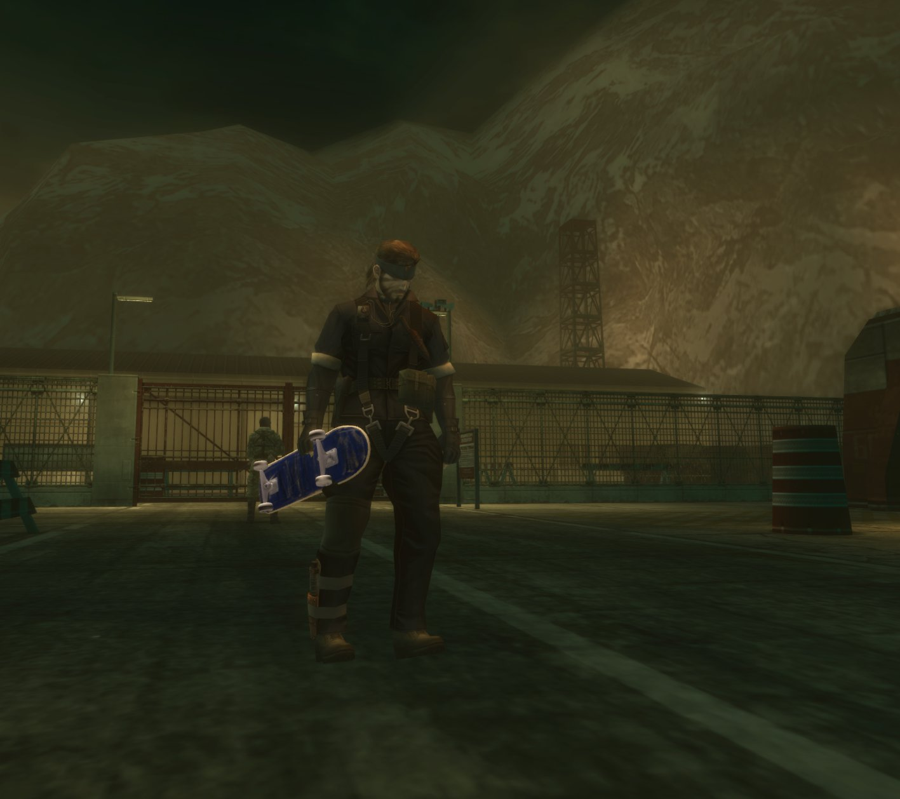

# Metal Gear Skate

Skate 3 skating inside METAL GEAR SOLID 3 (Master Collection Vol.1, Steam). Snake gets
on a board driven by the Skate 3 engine, riding MGS3's own stages and collision, with
Skate 3's controls, tricks, grinds and bails.

**No game files are included.** Setup builds what the mod needs from your own copies of both
games.

**Status: early but playable.** Snake skates on the genuine Skate 3 engine on MGS3's real stage
collision: pushing, flip tricks, grinds and bails, posed from the skater, on a textured board,
with the game's camera following. See "What works" below.

## What you need

1. **METAL GEAR SOLID 3** from Master Collection Vol.1 on Steam (64-bit `METAL GEAR SOLID3.exe`).
2. **Skate 3 for Xbox 360**: your own disc image (`.iso`), or an extracted copy (a folder with
   `default.xex` and `data`). A PS3 copy won't work.
3. **A controller.**

## Installing

1. Download a release zip and unpack it anywhere (or build from source, below).
2. Close the game and run `setup.cmd -WithHDFix` (recommended: MGSHDFix opens the developer menu
   the tested stages are loaded from, below; plain `setup.cmd` installs only an ASI loader). It:
   - finds MGS3 through Steam (or asks for its folder);
   - installs an ASI loader if there isn't one ([Ultimate ASI Loader](https://github.com/ThirteenAG/Ultimate-ASI-Loader)
     v9.7.4 as `wininet.dll`; `-WithHDFix` installs [MGSHDFix](https://github.com/ShizCalev/MGSHDFix) 4.1.2 instead);
   - copies `MetalGearSkate.asi`, `MetalGearSkate.core.dll` (as `plugins\MetalGearSkate\core.dll`) and
     `skate_ffi.dll` into the game's `plugins` folder;
   - asks for your Skate 3 `.iso` (or folder, or `default.xex`), unpacks it with
     [extract-xiso](https://github.com/XboxDev/extract-xiso) and converts the skate data from it with
     the converter of [2010 Rust Rewrite Mashup](https://github.com/chasmlol/2010-rust-rewrite-mashup)
     v0.4.0, into `%LOCALAPPDATA%\MetalGearSkate` (about 180 MB; the 6 GB unpacked copy can be deleted after);
   - with Python 3 and numpy installed, exports the skater's sounds from your disc (decoded with
     [vgmstream](https://github.com/vgmstream/vgmstream) r2117; about 1.3 GB, a few minutes);
     without them skating works, silently;
   - writes `plugins\MetalGearSkate.ini` and, if Python is installed, rides the engine for 10 s to check it.

   Every download is asked for first and pinned by version and SHA-256. Options:
   `setup.cmd -DryRun` (show the actions only), `-Skate3 <path>`, `-GameDir <path>`, `-DataDir <path>`,
   `-DataOnly` (only reconvert the Skate 3 data), `-SkipConvert`, `-Yes`.
3. Set up the developer menu (below), load a stage and press **F5** to start or stop skating.

### The developer menu (where the mod is tested)

Every release is tested on two stages loaded from MGS3's developer menu: Groznyj Grad Southwest
(`s091a`) and `(s092b)Night`. F5 works in the normal story too, but those areas aren't tested.
MGSHDFix can open that menu when the game starts:

1. Install with `setup.cmd -WithHDFix` (or install [MGSHDFix](https://github.com/ShizCalev/MGSHDFix)
   4.1.2 yourself).
2. Start the game once and close it, so MGSHDFix writes `plugins\MGSHDFix.settings`.
3. In that file, under `[Debugging]`, set `Start Game in Developer Menu=1` (or tick it in
   `plugins\MGSHDFix Config Tool.exe`). Optionally, under `[Launcher and Splashscreens]`,
   `Skip Launcher=1` starts the game without the launcher window.
4. Start the game. It opens in the developer menu, a Japanese debug menu: move with the d-pad,
   confirm with circle (B on an Xbox pad; if nothing happens, try cross / A).
5. Open `stage_select(snakeeater)` (not `stage_select(virtous)`), then:
   - Groznyj Grad Southwest: `s091a[+]`, then `(s091a_0)`.
   - `(s092b)Night`: open `s092a[+]` (just below `s091a[+]`), then `(s092b)Night`. This is the
     escape after the torture: Snake has no gear, and picking a weapon there crashes the game
     (with or without the mod).
6. Press **F5** to skate.

Uninstall: delete `plugins\MetalGearSkate.asi`, the `plugins\MetalGearSkate` folder, `plugins\skate_ffi.dll` and `plugins\MetalGearSkate.ini`,
and the `%LOCALAPPDATA%\MetalGearSkate` folder.

## Controls

**F5** (keyboard) starts or stops skating where Snake stands. On the board, Skate 3's own controls
(Xbox names; on PlayStation layouts A = cross, B = circle, Y = triangle):

| Input | Does |
|---|---|
| A | push |
| B (hold) | brake |
| Left stick | steer (carve) |
| Right stick: pull back, then flick up | ollie (flick up-left: kickflip, up-right: heelflip) |
| Right stick: push up, then flick back | nollie |
| Ollie onto a ledge or rail | grind |
| Y | step off the board and back on |
| Start | pause the game (the skater waits until you resume) |

## Troubleshooting

- **On foot, every button does everything, or nothing works:** use Konami's default Steam Input
  layout for MGS3. Community layouts built on the Gamepad template leave the game's actions
  unbound. If a Steam Controller is connected, Steam can list it as a broken first controller
  and the Xbox pad stops working: unplug it, or move the pad first in Steam's controller order.
  `logs\MGSHDFix_Game.log` lists the controllers and bindings the game sees. (With MGSHDFix's
  `Skip Launcher`, the game's button map stays empty; the mod fills it in.)
- **The game crashes when you pick a weapon on `(s092b)Night`:** that's the game, with or without
  the mod. That entry is the escape after the torture: Snake's gear was taken, so the weapons
  panel shows no icons, and selecting one crashes. Skate there, but leave the weapons menu alone.
- **Something went wrong:** `plugins\MetalGearSkate.log` says what the mod did. Include it in a
  bug report.

## What works

- Skating on the genuine Skate 3 engine inside MGS3: push, carve, brake (hold B), ollie, nollie,
  kickflip, heelflip, grinds (50-50, 5-0) on ledges, kerbs and rails, bails with the engine's own
  respawn, and stepping off to carry the board (Y).
- MGS3's real stage collision, loaded when you press F5. Short invisible walls don't stop you.
- Snake takes the skater's pose every frame. The board, with Skate 3's textures, is drawn into the
  game's own scene: under the HUD and subtitles, through its colour filter and bloom.
- MGS3's camera follows Skate 3's chase camera, so riding in any direction shows the whole stage.
- Skate 3's skater sounds: rolling by speed and surface, pops, flips, landings, grinds, bails.
- Riding off a stage puts you back where you last rode, and Snake takes no damage while skating.
- Start pauses the game while skating; F5 gets off the board for the game's menus, items and codec.
- Tested on Groznyj Grad Southwest and `(s092b)Night` from the developer menu.

## What's missing

- Board lighting is simple diffuse (no specular)
- A settings menu (settings live in `plugins\MetalGearSkate.ini`)
- Skateparks: Skate 3's props and spots placed on MGS3 stages
- Audio beyond the skater: Skate 3's ambience and speech (MGS3's own sound keeps playing)
- Guards still see the skater; knocking guards over with the board
- Carried off the board, the board clips Snake's legs a little
- The story's other areas aren't tested
- A full install on a clean machine hasn't been tried yet

## Building from source

1. Install [Visual Studio Build Tools 2022](https://visualstudio.microsoft.com/visual-cpp-build-tools/)
   with **Desktop development with C++**, and [Rust](https://rustup.rs).
2. Run `build.cmd`. It produces `mgs3-plugin\build\Release\MetalGearSkate.asi`,
   `mgs3-plugin\build\Release\MetalGearSkate.core.dll` and
   `skate-ffi\target\x86_64-pc-windows-msvc\release\skate_ffi.dll`.
3. Run `setup.cmd` from the repository: it installs the files you just built. `package.cmd` builds
   the release zip in `dist\` (binaries, setup, README, licences; no game data).
4. `plugins\MetalGearSkate.log` says what the mod did in game.

## Repository layout

| Folder | What |
|---|---|
| `mgs3-plugin/` | The game side, in C++: a small loader (`MetalGearSkate.asi`, an ASI plugin) and the plugin itself (`MetalGearSkate.core.dll`), which the loader can swap while the game runs |
| `skate-ffi/` | A 64-bit Rust DLL (`skate_ffi.dll`) wrapping the Skate engine in a C API |
| `mashup/` | The Skate engine crates, taken from [2010 Rust Rewrite Mashup](https://github.com/chasmlol/2010-rust-rewrite-mashup) at `f608f85` with its licence and notice |
| `setup.cmd`, `tools/` | Player setup: install, Skate 3 data conversion, sound export, engine check; `package.cmd` builds the release zip |
| `docs/` | Screenshots, and notes on MGS3's formats and memory for other modders (`docs/formats.md`) |

## Credits

- Skate engine: [skate-3-rust-engine](https://github.com/SK8-ENGINE/skate-3-rust-engine) (GPL-3.0)
  by dumbad and contributors, as used in [2010 Rust Rewrite Mashup](https://github.com/chasmlol/2010-rust-rewrite-mashup)
  by chasmlol, a fork of [IW4L](https://github.com/vladtrc/iw4L) by vladtrc (Apache-2.0).
- Repository structure follows [GTA San AnSkateas](https://github.com/ryglizzy/GTA-San-AnSkateas) by ryglizzy.
- Direct3D 11 hooking approach (Present, state save/restore, coexisting hooks) studied from
  [MGSHDFix](https://github.com/ShizCalev/MGSHDFix) by ShizCalev and contributors (MIT).
- Skater audio: `skate-audio` / `skate-audio-fma` (vendored in `mashup/`), the host files in
  `skate-ffi/src/audio/` (ported from `game_audio/`) and the disc audio export in
  `tools/skate_audio_export/` (`tools/asset_pipeline/`) all come from
  [skate-3-rust-engine](https://github.com/SK8-ENGINE/skate-3-rust-engine) at `b3c96793` (GPL-3.0),
  whose audio port credits its own specs and the community's research; the export's BIG/RefPack
  readers are MIT (Skate 3 Custom Engine Layer contributors, notices kept with them).
- Grind rail finder (`skate-ffi/src/rails.rs`) ported from `render_anim/src/skate/rails.rs` in
  [2010 Rust Rewrite Mashup](https://github.com/chasmlol/2010-rust-rewrite-mashup) by chasmlol (Apache-2.0).
- Setup downloads, each under its own licence (kept beside the files it installs):
  [Ultimate ASI Loader](https://github.com/ThirteenAG/Ultimate-ASI-Loader) by ThirteenAG (MIT),
  [MGSHDFix](https://github.com/ShizCalev/MGSHDFix) (MIT, optional),
  [extract-xiso](https://github.com/XboxDev/extract-xiso) (its `LICENSE.TXT`), the Skate 3 data
  converter from [2010 Rust Rewrite Mashup](https://github.com/chasmlol/2010-rust-rewrite-mashup) v0.4.0
  (Apache-2.0, with its NumPy, Pillow and Python licences) and
  [vgmstream](https://github.com/vgmstream/vgmstream) r2117 (ISC, its `COPYING`).
- Release zips also carry the licences of [safetyhook](https://github.com/cursey/safetyhook) (BSL-1.0),
  Zydis/Zycore (MIT) and the Rust crates linked into `skate_ffi.dll` (`licenses/rust-crates.md`).
- MGS3 format research: Jayveer, Joy-Division, GirianSeed and others; see `docs/formats.md`.

## License

GPL-3.0-only (see `LICENSE`), to match the Skate 3 Rust Engine. Unofficial fan project, not
affiliated with Konami or EA. You need to own METAL GEAR SOLID 3 and Skate 3.
