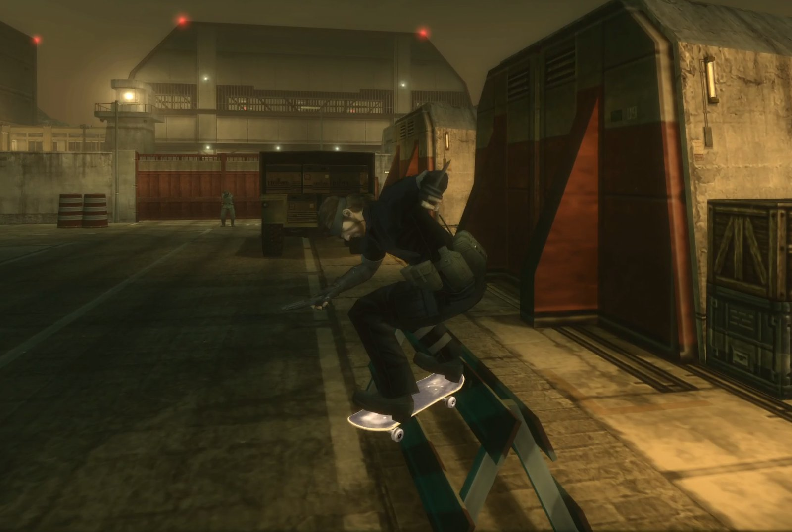
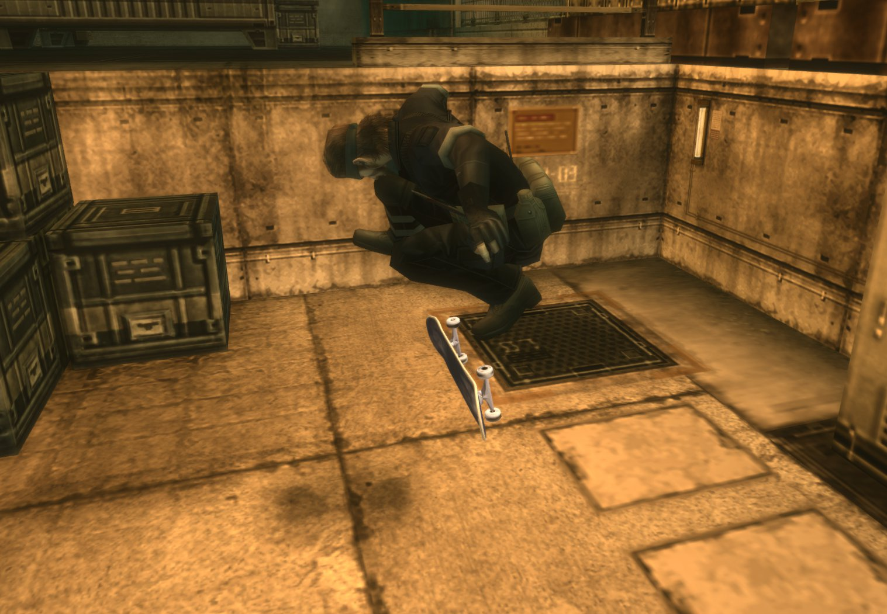
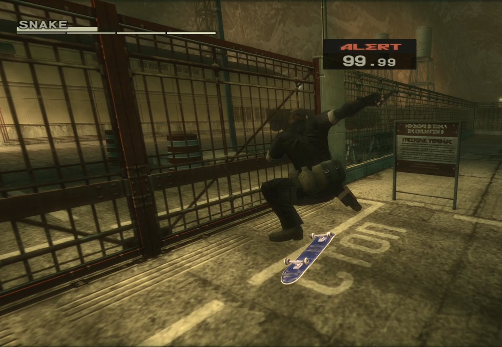

# Metal Gear Skate 3

Skate 3 skating inside METAL GEAR SOLID 3 (Master Collection Vol.1, Steam): Snake rides MGS3's
own stages on the genuine Skate 3 engine, with Skate 3's controls, tricks, grinds, bails and
sounds. **No game files are included**: setup builds what the mod needs from your own copies.

 

## What you need

- **METAL GEAR SOLID 3** from Master Collection Vol.1 on Steam.
- **Skate 3 for Xbox 360**: your own disc image (`.iso`) or an extracted copy. A PS3 copy won't work.
- **A controller.** Python 3 with numpy is optional: setup uses it to export the skater's sounds.

## Installing

1. Download the release zip and unpack it anywhere.
2. Close the game and run `setup.cmd -WithHDFix`. It finds MGS3, installs
   [MGSHDFix](https://github.com/ShizCalev/MGSHDFix) and the mod, and converts your Skate 3 disc
   into `%LOCALAPPDATA%\MetalGearSkate` (about 180 MB). Every download is pinned by version and
   SHA-256; `setup.cmd -DryRun` shows what it would do.
3. Start the game once and close it, then in `plugins\MGSHDFix.settings` set
   `Start Game in Developer Menu=1` (under `[Debugging]`). The game now opens in its developer menu.
4. In the menu (d-pad to move, circle / B to confirm), open `stage_select(snakeeater)`, then
   `s091a[+]` → `(s091a_0)` for Groznyj Grad Southwest, or `s092a[+]` → `(s092b)Night`.
5. Press **F5** to start or stop skating.

These two stages are the tested ones. F5 works elsewhere in the story too, untested.
To uninstall, delete `plugins\MetalGearSkate.asi`, `plugins\MetalGearSkate\`,
`plugins\skate_ffi.dll`, `plugins\MetalGearSkate.ini` and `%LOCALAPPDATA%\MetalGearSkate`.

## Controls

On the board, Skate 3's own controls (PlayStation: A = cross, B = circle, Y = triangle):

| Input | Does |
|---|---|
| A | push |
| B (hold) | brake |
| Left stick | steer |
| Right stick: pull back, flick up | ollie (up-left: kickflip, up-right: heelflip) |
| Right stick: push up, flick back | nollie |
| Ollie onto a ledge or rail | grind |
| Y | step off and carry the board |
| Start | pause |
| F5 (keyboard) | get on or off the board |

## Troubleshooting

- **On foot, every button does everything, or nothing works:** use Konami's default Steam Input
  layout for MGS3, and unplug a Steam Controller if Steam lists it ahead of your pad.
- **The game crashes when you pick a weapon on `(s092b)Night`:** that's the game itself (Snake's
  gear was taken in that part of the story). Skate there, but leave the weapons menu alone.
- **Anything else:** `plugins\MetalGearSkate.log` says what the mod did. Include it in a bug report.

## Known issues

- Guards still see the skater, and the board can't knock them over.
- Carried off the board, the board clips Snake's legs a little.
- No settings menu (settings live in `plugins\MetalGearSkate.ini`); simple board lighting.
- Only the skater's sounds: no Skate 3 ambience or speech.

## Building from source

Install [Visual Studio Build Tools 2022](https://visualstudio.microsoft.com/visual-cpp-build-tools/)
(Desktop development with C++) and [Rust](https://rustup.rs), run `build.cmd`, then `setup.cmd`
to install what you built. `package.cmd` makes the release zip. MGS3 notes for other modders are
in `docs/formats.md`.

## Credits

- Skate engine: [skate-3-rust-engine](https://github.com/SK8-ENGINE/skate-3-rust-engine) (GPL-3.0)
  by dumbad and contributors, via chasmlol's [2010 Rust Rewrite Mashup](https://github.com/chasmlol/2010-rust-rewrite-mashup)
  (Apache-2.0), itself a fork of vladtrc's [IW4L](https://github.com/vladtrc/iw4L). The skater's
  audio, its disc export and the grind rail finder come from the same two projects.
- Inspired by and structured like ryglizzy's [GTA San AnSkateas](https://github.com/ryglizzy/GTA-San-AnSkateas).
- Direct3D 11 hooking studied from [MGSHDFix](https://github.com/ShizCalev/MGSHDFix) (MIT).
- MGS3 format research: Jayveer, Joy-Division, GirianSeed and others.
- Setup downloads [Ultimate ASI Loader](https://github.com/ThirteenAG/Ultimate-ASI-Loader),
  MGSHDFix, [extract-xiso](https://github.com/XboxDev/extract-xiso), the mashup's data converter
  and [vgmstream](https://github.com/vgmstream/vgmstream), each under its own licence, kept beside
  the files it installs. Release zips carry the licences of safetyhook, Zydis and the Rust crates.

## License

GPL-3.0-only, to match the Skate 3 engine. Unofficial fan project, not affiliated with Konami or
EA. You need to own METAL GEAR SOLID 3 and Skate 3.
